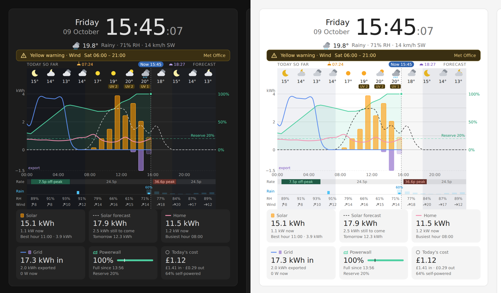

# Energy & Weather Timeline Card

A Home Assistant dashboard card with:

- a clock with the current weather beside it: a big temperature, the condition, humidity, chance of rain and wind
- a weather-warning banner and a red storm alert
- one sliding timeline with now always in the centre, joining yesterday, today and tomorrow: hourly weather, solar production and forecast, home use, grid import/export, battery charge with backup reserve, import and export tariff periods, rain, humidity and UV
- summary cells underneath: solar with its forecast, a small power flow, home, grid, the battery with its time left, and today's import cost and export income
- optional rows for your solar strings (A–F, in pairs), other batteries and devices

It was built and checked against Home Assistant 2026.10. It is a single file with no external downloads, so it works offline and in the Companion app.



## Install with HACS

[](https://my.home-assistant.io/redirect/hacs_repository/?owner=sencercoltu&repository=energy-weather-timeline-card&category=plugin)

Or add it by hand:

1. Open **HACS → ⋮ → Custom repositories**.
2. Repository: `https://github.com/sencercoltu/energy-weather-timeline-card`. Type: **Dashboard**.
3. Search HACS for **Energy & Weather Timeline Card**, open it and select **Download**.
4. Reload the browser.

HACS registers the dashboard resource for you and offers future releases as updates.

## Install manually

1. Copy `dist/energy-weather-timeline-card.js` to `/config/www/`.
2. Go to **Settings → Dashboards → ⋮ → Resources → Add resource**.
   - URL: `/local/energy-weather-timeline-card.js`
   - Type: **JavaScript module**
3. Hard-refresh the browser.

After either install, edit a dashboard → **Add card** → **Energy & Weather Timeline**.

## Visual editor

Every option is in the card editor, grouped into **Clock and weather**, **Solar**, **Home and grid**, **Batteries**, **Devices**, **Battery**, **Tariff and cost**, **Show or hide** and **Colours and spacing**. Leave out any entity you don't have, and the parts of the card that need it will hide themselves.

The tariff periods use a small YAML box inside the editor:

```yaml
- start: "00:30"
  end: "05:30"
  rate: 0.075
  type: off_peak
- start: "16:00"
  end: "19:00"
  rate: 0.366
  type: peak
```

`type` is `off_peak`, `standard` or `peak`. Any hour not listed uses **Standard import rate**. Rates are in your currency per kWh, so 0.245 means 24.5p. An optional `label:` replaces the default "off-peak" or "peak" text.

**Import price entity.** If your import price lives in its own entity (for example Octopus Energy's *current rate* sensor or its *current day rates* event), pick it under **Tariff and cost** instead of listing periods. It is read the same way as the export price entity below and drawn as the **Buy** band. With neither periods nor an entity, the **Standard import rate** alone still gives a flat Buy band.

**Export tariff periods** use the same format with your export rates, for example a peak export window:

```yaml
- start: "16:00"
  end: "19:00"
  rate: 0.29
  type: peak
```

Any hour not listed uses **Standard export rate**. When export periods are set, the timeline shows two bands, **Buy** and **Sell**. Leave them out if your export rate is flat; the flat rate is still used for today's income.

**Export price entity.** If your export price lives in its own entity, pick it under **Tariff and cost**; it takes priority over the export periods. Past hours come from its recorded history. Upcoming hours come from a list of rates in its attributes, if it has one, for example Octopus Energy's *export current day rates* event or Nord Pool's `raw_today` / `raw_tomorrow`. Without such a list, the Sell band stops after the current rate period. Units such as GBP/kWh and p/kWh are converted, and the browser console (F12) says which parts of the entity were used.

**Standing charge.** Pick your daily standing charge entity under **Tariff and cost**, for example Octopus Energy's *current standing charge* sensor. It is added in full to today's cost and shown in grey in the money cell (figure and bar segment), first, before bought and sold. Pence or cents per day are converted; a bare number of 10 or more with no unit is taken as pence or cents.

**Timeline length** (under **Show or hide**) is 24, 36 or 48 hours, with now always in the centre. The past half comes from your history, reaching back into yesterday; the future half comes from the weather and solar forecasts, reaching into tomorrow. Each midnight is marked with the day's name. The blue **Now** label and every sunrise and sunset in view are marked at the top; a sunrise or sunset next to now moves beside the label instead of hiding under it.

**Graph toggles.** Chips under the graph show or hide **Battery** (the charge line and the reserve line), **Forecast**, **Home**, **Grid** (import) and **Export**; tap one to switch it. The kWh axis fits what is shown, and the summary tiles still count everything. Each browser remembers its own choice, so a wall tablet and your phone can show different lines. Turn the chips off with **Graph toggles** under **Show or hide**; the graph then shows every line.

**Solar cell.** Today's production with a bar against today's forecast — the mark on it is where the forecast expected production to be by now — and the solar power now at the top right. Under it, the forecast for today with what is still to come (the dashed line, like the forecast on the graph), and tomorrow's forecast. Hover the cell for the best hour so far. Without a forecast, the best hour takes the forecast's line.

**Power flow.** The second cell shows solar (top), grid (left), battery (right) and home (bottom), with their power now in small figures, and a line from each source to each place its power can go: solar to the home, the battery and the grid; the battery to the home and the grid; the grid to the home and the battery (grid and battery share one line, used either way). The lines turn with a curve near the middle and each has its own lane, so none lies on another. The power on each line is worked out from the four readings: solar goes to the home first, then the battery, then the grid; the battery feeds the home, then the grid; the grid feeds the home, then the battery. A line carrying power is lit in its source's colour and dots run along it from the source; hover the cell for each line's power. The grid icon takes the export colour while exporting, and the battery icon is filled to its charge. With reduced motion turned on in the device's settings, the lines stay lit without dots. Turn the cell off with **Power flow cell** under **Show or hide**.

**Solar strings.** Under **Solar**, pick each string's power sensor, **String A power** to **String F power** (a Powerwall 3 has inputs A–F; set only the ones you use). They appear in a row across the full width, under the other cells, grouped in their pairs — A and B, C and D, E and F — each pair in its own colour. Each string shows its power now over a thin bar measured against the strongest string, so a shaded or failed string stands out; the header has the strings' total. Hover a string for its share of the total and its pair's sum. A string below 5 W is faded, and an unavailable sensor shows a dash.

**Batteries.** Under **Batteries**, add any batteries you want to watch — an EV, an e-bike, a phone, a power bank — each with its state of charge entity (in %), an optional charging-state entity and a name. They appear in one cell across the full width, above Devices. Each is a battery-shaped bar filled to its charge: red up to 20 %, yellow at 60 %, green at 100 %, blended in between. While a battery charges, stripes move across the fill and a bolt sits by the percentage, and the header counts the batteries charging. The charging state can be on/off (a binary sensor, switch or input boolean), a state such as `charging` (`not charging`, `discharging` and `fully charged` count as not charging), or a number above zero, such as a charging power. **Batteries per row** sets the columns (3 by default; a very narrow card shows at most 2). With reduced motion turned on in the device's settings, the stripes stand still.

**Devices.** Under **Devices**, add each appliance that has a live power sensor (an EV charger, a heat pump …) and give it a name; an empty name uses the sensor's own. They appear in one cell across the full width, under the summary cells, with the devices' total at the top. Each device takes one line — its name, its share of the home's use right now (this needs **Home power now**), and its power at the right end — over a bar of that share. Where the text lies on the bar it switches to near-black or white, whichever reads better on the bar's colour. **Devices per row** sets the columns (3 by default; a very narrow card shows at most 2), and **Bar height** the bar (18 px by default; from 14 px the bar is the line's background, below that it is a thin bar under the line). **Other** is the home's power minus the listed devices, so the shares add up to 100 %; it is shown in grey, and **Show Other** turns it off. A device using less than 5 W is shown faded, and an unavailable sensor shows a dash. W and kW sensors both work.

**Colours and spacing.** Set the padding inside the card (20 px by default) and pick your own colours for **Solar**, **Solar forecast**, **Home and devices**, **Grid import** and **Export**. Each colour is used on the graph, its chip and its cell; the devices use the home colour, and the money cell uses the grid and export colours for bought and sold. In YAML a colour can also be written as `"#F48FB1"` or `[244, 143, 177]`. To go back to a default colour, delete its line in the code editor.

## What each entity needs

- **Energy sensors** (solar, home, grid import, grid export, rain gauge) are cumulative meters, the same ones the Energy dashboard uses. The card reads their hourly statistics. A sensor without statistics (no `state_class`) is read from the recorder history instead. If an energy sensor is missing, or shows no change today while the matching power sensor shows a flow, the card integrates that power sensor over the day instead; for grid power, positive counts as import and negative as export. The browser console (F12) says which source each flow came from.
- **Battery state of charge, weather and the import and export price entities** are read from the recorder history.
- **Weather** must support hourly forecasts. The card subscribes to them, so the forecast hours update live.
- **Solar forecast**: pick a *forecast today* sensor whose attributes hold the hour-by-hour (or half-hourly, 15-minute) forecast, as Solcast and Open-Meteo Solar Forecast do. The card finds the series in the attributes whatever its layout and works out the unit by matching the sensor's daily total. If you leave the entity empty, or it has no such attributes, the card uses the forecast linked to your solar panels in the Energy dashboard. The browser console (F12) shows one line saying which source it used, or why it found none.
- **Power sign conventions**:
  - Grid power: positive = importing.
  - Battery power: positive = discharging. This is the Powerwall/pypowerwall convention.
  - If yours are the other way round, use the invert toggles.
- **Weather warning**: any entity that is `on` (or carries a `warnings` list) while a warning is active, for example a MeteoAlarm binary sensor. The headline, severity colour and start/end times are read from its attributes.

## Example (YAML mode)

The entity IDs below are placeholders; pick yours in the editor.

```yaml
type: custom:energy-weather-timeline-card
weather_entity: weather.home
warning_entity: binary_sensor.meteoalarm
solar_energy_entity: sensor.powerwall_solar_energy
solar_power_entity: sensor.powerwall_solar_power
solar_forecast_tomorrow_entity: sensor.energy_production_tomorrow
string_a_entity: sensor.powerwall_string_a_power   # optional, one per string; also string_b_entity … string_f_entity
string_b_entity: sensor.powerwall_string_b_power
home_energy_entity: sensor.powerwall_home_energy
home_power_entity: sensor.powerwall_load_power
grid_import_entity: sensor.powerwall_grid_import
grid_export_entity: sensor.powerwall_grid_export
grid_power_entity: sensor.powerwall_site_power
battery_name: Powerwall
battery_soc_entity: sensor.powerwall_charge
battery_unit_soc_entities:   # optional: main battery first, then expansions
  - sensor.powerwall_battery_1_charge
  - sensor.powerwall_battery_2_charge
battery_power_entity: sensor.powerwall_battery_power
battery_capacity: 27
battery_reserve: 20
devices:                     # optional: live power sensors with a name each
  - entity: sensor.ev_charger_power
    name: EV
  - entity: sensor.heat_pump_power
    name: Heat pump
devices_columns: 3           # optional
batteries:                   # optional: any batteries to watch
  - entity: sensor.car_battery_level
    charging_entity: binary_sensor.car_charging
    name: EV
  - entity: sensor.phone_battery_level
    charging_entity: sensor.phone_battery_state
    name: Phone
devices_bar_size: 18         # optional, px
standing_charge_entity: sensor.octopus_energy_electricity_xxxx_current_standing_charge   # optional
tariff:
  - { start: "00:30", end: "05:30", rate: 0.075, type: off_peak }
  - { start: "16:00", end: "19:00", rate: 0.366, type: peak }
standard_rate: 0.245
export_rate: 0.15
export_tariff:
  - { start: "16:00", end: "19:00", rate: 0.29, type: peak }
# or, instead of export_tariff, an entity with your export price:
# export_rate_entity: event.octopus_energy_electricity_xxxx_export_current_day_rates
timeline_hours: "24"
card_padding: 16             # optional, default 20
home_color: "#F48FB1"        # optional; also solar_color, forecast_color, grid_color, export_color
```

## More cards in this file

The same file also holds two smaller cards. They are in the card picker as **Temperature (EWT)** and **Heating circuits (EWT)**, with their own editors; nothing extra to install.

**Temperature** (`custom:ewt-temperature-card`): any number of temperature sensors in one card, each in its own cell — the name and a big temperature, and a graph of the temperature over the last hours behind the lower half of the cell (only the temperature is drawn), with a dot at now and the window's range in the bottom left corner. Give it a humidity sensor and its value (in %) shows in blue in the bottom right corner. Instead of a temperature sensor you can pick a thermostat (`climate`) or a water heater: the card uses its current temperature, now and in the graph. A thermostat that reports humidity shows it on its own, and a thermostat or humidifier can also be the humidity entity. The cells sit in a grid (`columns`, 3 by default), under an optional `title`; in a sections view the card asks for enough rows to give each cell about 80 px, and you can give it more in the **Layout** tab. A single sensor without a title fills the card on its own (4 columns × 2 rows in a sections view).

```yaml
type: custom:ewt-temperature-card
title: Rooms                               # optional
hours: 24                                  # optional, graph length
columns: 3                                 # optional
show_range: true                           # optional
color: "#F2994A"                           # optional, graph colour for sensors without their own
entities:
  - entity: sensor.utility_temperature
    humidity_entity: sensor.utility_humidity   # optional
    name: Utility                              # optional
  - entity: sensor.kitchen_temperature
    humidity_entity: sensor.kitchen_humidity
  - entity: climate.living_room                # a thermostat: its current temperature (and humidity, if it reports one)
  - entity: sensor.heating_ebusd_hwc_storage_temp
    name: HW Temp
    color: "#6F8FB8"                           # optional, this sensor's graph colour
```

**Heating circuits** (`custom:ewt-heating-circuits-card`): one row per circuit — icon, name, a strip showing when it ran over the last hours, and its state. The run going on now is in full colour; hover a run for its times. A state of `on`, `heat`, `heating`, `running`, `active` or `open` counts as running; a number counts as running above the circuit's `threshold` (0 if not set), and then shows its value with unit, such as a flow temperature. Without an `icon`, the entity's own icon is used if it has one. Its default size is 8 columns, with rows for the number of circuits.

```yaml
type: custom:ewt-heating-circuits-card
hours: 12                                  # optional, timeline length
title: Heating                             # optional
circuits:
  - entity: sensor.heating_ebusd_ctlv3_hc1pumpstatus
    name: UFH
    icon: mdi:heating-coil
  - entity: sensor.heating_ebusd_ctlv3_hc2pumpstatus
    name: Radiators
    icon: mdi:radiator
  - entity: sensor.heating_ebusd_ctlv3_hwcflowtemp
    name: Hot Water
    icon: mdi:water-boiler
    threshold: 1                           # running while the flow temperature is above 1
```

Both read the recorder history when they load and every 5 minutes, and redraw as the states change.

## Good to know

- **Time zone.** The clock and the timeline follow the time zone in your Home Assistant profile, not the device's. You can set a fixed `time_zone` instead.
- **Cost and income are approximate.** Both are worked out per hour: price entities at the average of the hour's two half hours, tariff periods at the rate in force at the middle of the hour. A tariff period that changes on a half hour (00:30, 05:30) will be a few pence off your bill. The money tile shows the net amount ("Net cost", or "Net earnings" in green when export income is larger) with a bar splitting the standing charge, what you bought and what you sold; then one line with the sum that gives the net — standing + bought − sold — each figure underlined in its bar colour (hover for the words); then the self-powered share.
- **Self-powered %** is the share of home use not covered directly by grid import in each hour. That's close to how the Tesla app reports it.
- **The running hour** is shown dashed. Its value comes from the live meter reading, so it updates as you watch.
- **Battery tile.** The big number and the bar are the total charge. If you pick **Each battery's state of charge** (main battery first, then each expansion), each battery gets a thin line under the bar with its percentage; hover for the names. The bar and each battery's line are one solid colour, taken from a scale at that charge level: red up to the backup reserve, yellow up to 50 %, green from 80 %, blended in between. The reserve mark runs through all of them. The graph's charge line, its shaded area and the dot at now use the same scale, and the reserve line is red. Without a total charge entity, the average of the batteries is shown.
- **Battery time left** needs **Usable battery capacity**. Discharging: time until the backup reserve, and the clock time. Charging: time until full. Idle or full: how long it would last at the current home use. Anything over two days shows as "2+ days".
- **Storm alert.** A red label appears when the hourly forecast for the next 24 hours has thunder, hail or exceptional weather, or gusts of 75 km/h (or a mean wind of 55 km/h) and above. The affected hours are marked red on the timeline. Turn it off with **Storm alert** under **Show or hide**.
- **Light themes** are supported; the card switches its night shading and icon colours automatically.
- **Sections view.** The card starts at 12 columns × 12 rows and fits whatever size you give it in the card's **Layout** tab (at least 6 columns × 7 rows). The graph grows or shrinks to fill the space; when space is tight, the humidity row, rain lane, tariff bands, graph toggles, summary tiles and weather icons are left out, in that order. In other views the card is as tall as its content.
- **Today only.** The summary tiles (solar, home, grid, cost and income, self-powered %) always count from midnight to now. Only the graph reaches into yesterday and tomorrow.
- **Large totals.** Energy totals of 1000 kWh and above are shown in MWh with two decimals.
- **Axis.** The kWh axis counts in round steps (0.5, 1, 2, 5, 10 … kWh), as many as the graph's height has room for. The battery's 100 / 50 / 0 % labels sit inside the graph against its right edge; one that would touch the reserve label is left out.
- **Impossible hours.** A home can't use or produce more than 100 kWh in an hour. When a fifth or more of an energy sensor's hours read above that, its values are taken as Wh and divided by 1000. A single hour above it is a meter that dropped to zero and came back, so it is left out. Either way the browser console (F12) names the sensor and the hours.
- **Versions.** The version is shown in the card picker and in the browser console. In the GitHub repo, changing `CARD_VERSION` and pushing publishes a matching release automatically, which HACS then offers as an update.
